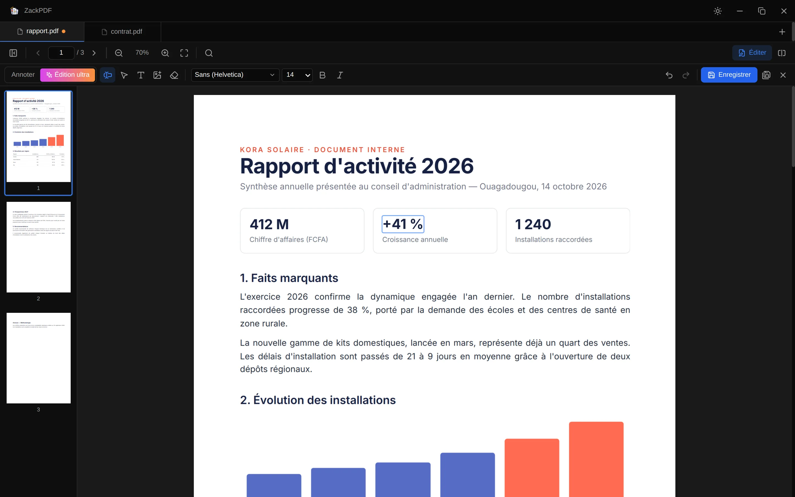

<p align="center">
  
</p>

<h1 align="center">ZackPDF</h1>

<p align="center">
  Un lecteur PDF gratuit et open source, avec onglets et panneaux côte à côte.<br>
  Pour Windows, macOS et Linux.
</p>

<p align="center">
  <a href="https://codebydarknet.github.io/zackpdf/"><b>Site et téléchargements</b></a> ·
  <a href="https://github.com/codeByDarknet/zackpdf/releases/latest">Dernière version</a> ·
  <a href="https://github.com/codeByDarknet/zackpdf/issues/new/choose">Signaler un bug</a>
</p>

<p align="center">
  <a href="https://github.com/codeByDarknet/zackpdf/actions/workflows/ci.yml"></a>
  <a href="https://github.com/codeByDarknet/zackpdf/releases/latest"></a>
  <a href="LICENSE"></a>
</p>



## Fonctionnalités

- **Annotations** : surligner, souligner, barrer, ajouter du texte, dessiner à main levée, formes, flèches et images
- **Édition ultra** : modifier ou supprimer le texte d'origine du PDF comme dans un traitement de texte, effacer une zone, insérer des images. L'ancien texte est réellement retiré du fichier, pas seulement masqué
- Enregistrement en place (`Ctrl + S`) ou sous un nouveau nom (`Ctrl + Maj + S`), annulation illimitée (`Ctrl + Z` / `Ctrl + Y`), collage d'images depuis le presse-papiers
- **Panneaux côte à côte** pour comparer deux documents, ou deux endroits du même document
- **Onglets** que l'on peut réordonner et glisser d'un panneau à l'autre
- **Recherche dans tout le document** avec surlignage des occurrences (`Ctrl + F`)
- **Reprise de lecture** : onglets, panneaux et page courante restaurés au redémarrage
- **Miniatures**, zoom (`Ctrl + molette`, `Ctrl + +`, `Ctrl + −`, `Ctrl + 0`)
- **Thème clair et sombre**
- **Ouverture par double-clic** ou « Ouvrir avec » depuis le gestionnaire de fichiers
- Glisser-déposer de fichiers PDF dans la fenêtre
- 100 % hors ligne : aucun document ni aucune donnée ne quitte l'ordinateur

## Installation

Téléchargez la version pour votre système sur le [site](https://codebydarknet.github.io/zackpdf/#telecharger) ou dans les [releases GitHub](https://github.com/codeByDarknet/zackpdf/releases/latest).

| Système                 | Fichier                                                                                  |
| ------------------------ | ---------------------------------------------------------------------------------------- |
| Windows 10/11            | `ZackPDF-Windows-Setup.exe` (installateur) ou `ZackPDF-Windows-Portable.exe` |
| macOS Apple Silicon      | `ZackPDF-macOS-arm64.dmg`                                                          |
| macOS Intel              | `ZackPDF-macOS-x64.dmg`                                                            |
| Ubuntu, Debian, Mint…   | `zackpdf_amd64.deb`                                                                |
| Fedora, openSUSE…       | `zackpdf.x86_64.rpm`                                                               |
| Toute distribution Linux | `ZackPDF-Linux-x86_64.AppImage` ou `ZackPDF-Linux-x64.tar.gz`                |

> **Applications non signées.** Les certificats Apple et Microsoft sont payants et l'application n'en a pas encore.
>
> - **Windows** : « Windows a protégé votre ordinateur » → *Informations complémentaires* → *Exécuter quand même*.
> - **macOS** : clic droit sur l'app → *Ouvrir*. Si macOS la dit endommagée : `xattr -cr "/Applications/ZackPDF.app"`.

## Développement

Prérequis : [Node.js](https://nodejs.org/) 20 ou plus récent.

```bash
git clone https://github.com/codeByDarknet/zackpdf.git
cd zackpdf
npm install
npm run dev          # lance l'application avec rechargement à chaud
```

| Commande               | Rôle                                         |
| ---------------------- | --------------------------------------------- |
| `npm run dev`        | Lance l'application en développement         |
| `npm run typecheck`  | Vérifie les types TypeScript                 |
| `npm run build`      | Compile l'interface et le processus principal |
| `npm run dist:linux` | Construit les paquets Linux dans `release/`  |
| `npm run dist:win`   | Construit les paquets Windows                 |
| `npm run dist:mac`   | Construit les paquets macOS (sur un Mac)      |

### Technologies

[Electron](https://www.electronjs.org/), [React](https://react.dev/), [TypeScript](https://www.typescriptlang.org/), [Vite](https://vitejs.dev/), [react-pdf](https://github.com/wojtekmaj/react-pdf) / [PDF.js](https://mozilla.github.io/pdf.js/), [Zustand](https://github.com/pmndrs/zustand), [Tailwind CSS](https://tailwindcss.com/) et [Radix UI](https://www.radix-ui.com/).

### Structure

```
electron/          processus principal (fenêtre, fichiers, « Ouvrir avec ») et preload
src/
  components/      interface : panneaux, onglets, visionneuse, recherche, miniatures
  store/           état de l'application (Zustand) et sauvegarde de session
  lib/             cache des fichiers, recherche dans le texte PDF
build/             icônes utilisées pour les paquets
website/           site de présentation (publié sur GitHub Pages)
```

## Publier une nouvelle version

1. Mettre à jour `version` dans `package.json` et le [CHANGELOG](CHANGELOG.md).
2. Créer et pousser un tag :
   ```bash
   git tag v1.0.1
   git push origin v1.0.1
   ```
3. GitHub Actions construit l'application pour Windows, macOS et Linux et publie la release. Les liens du site pointent automatiquement vers la dernière version.

## Contribuer

Les contributions sont les bienvenues ! Lisez le [guide de contribution](CONTRIBUTING.md) pour commencer.

## Licence

[MIT](LICENSE) © 2026 Abdoul Razack Ouedraogo
